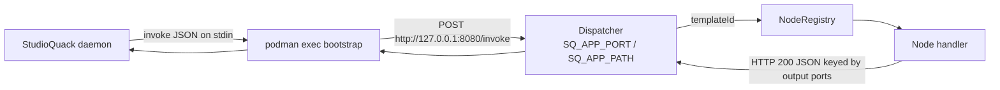

# SQ Builtin Node Library

The official StudioQuack node deck: **one OCI image that serves every built-in workflow node**,
dispatched by `templateId`.

[](LICENSE)

## What it is

StudioQuack is a visual workflow-automation platform. Workflows execute on the customer's
StudioQuack execution daemon (**SQS**), never on the cloud control plane.

Every built-in node in the StudioQuack catalog — AI Agent, model providers, HTTP, databases,
messaging, SaaS connectors, file and data transforms — is served by this one image: a Java
dispatcher behind a single HTTP listener that routes each request to the handler registered for
its `templateId`. Node packages live under `nodes/<key>/`; the full list is in
[docs/NODE_CATALOG.md](docs/NODE_CATALOG.md).

## How the platform runs it

The library is **platform-managed**. Nobody builds, registers or starts it by hand.

- **Built on the customer host at install.** Each StudioQuack release ships this repository's
  build context (`Containerfile`, `pom.xml`, `src/`, `helper-src/`, `nodes/`, `LICENSE`,
  `NOTICE.md`) as a signed tarball. On first boot the daemon verifies the signature and sha256,
  builds `sq-local/sq-builtin-node-library:<version>` with Podman, and starts it before the first
  workflow runs.
- **One always-on system instance.** The daemon keeps exactly one stateful instance of the image
  (`sq-builtin-node-library`) running for its environment, supervises it, and restarts it when it
  stops. It runs without CPU, memory or disk limits because it is the engine's own runtime. Engine
  Settings shows it as platform-managed: its logs are readable, but it cannot be stopped, started
  or exec'd into.
- **Updated without downtime.** When a new library release is staged, the daemon rebuilds the
  image and starts a successor next to the running instance. Requests switch to the successor once
  its listener accepts connections; the old container finishes its in-flight requests and is then
  removed. Node contracts must therefore stay backward-compatible between releases.
- **Runs wait for it.** A run does not start until the library is usable, because every
  workflow — even a None Start → None End graph — consists of built-in nodes.

### How a built-in node is executed

Every built-in node definition names this image in `executionRequirementsDto.ociImageRef`. The
daemon routes by image, not by a per-node flag:

1. **The system instance serves the request.** Requests are queued per container; the image
   carries `LABEL studioquack.sqs.dispatch=1`, so up to
   `sqs.sandbox.oci.stateful-dispatch-parallelism` (default 8) requests run in parallel.
2. **Cold start when no instance is running.** If no instance is live at that moment — for
   example right after a host restart — the dispatch cold-starts **the same platform instance**
   (same identity, no resource limits), waits until its listener accepts TCP, serves the request
   through it, and leaves it running for the next request.
3. **No fallback.** If that cold start fails, the node fails with a container error. Built-in
   nodes never run in a warm-pool slot or a one-shot container; those exist only for script nodes
   that run on a language image.

## Runtime contract

The image implements the StudioQuack BYO runtime contract:

- listen on `SQ_APP_PORT` + `SQ_APP_PATH` (defaults `8080` and `/invoke`);
- also serve `POST $SQ_APP_PATH/stream` (NDJSON in, SSE out) for live frames;
- accept a JSON invoke body that includes `templateId` and `inputVariables`;
- reply **HTTP 200** with a JSON object keyed by output-port names (unary) or SSE
  `complete`/`error`/`done` (stream);
- call back to the daemon only over `SQ_HELPER_SOCKET` (never a host HTTP helper).



Helper calls (`studioquack.execute`, the daemon's LLM proxy, structured failures, logs) leave the
container over the in-container Unix socket `SQ_HELPER_SOCKET`, authenticated with a per-request
`helperToken`. Handlers must be thread-safe. Details: [docs/architecture.md](docs/architecture.md).

## Developing nodes

You need JDK 21+, Maven 3.9+ and Podman.

```bash
mvn -q test                                                  # catalog, contract audit and handler tests
podman build -t sq-local/sq-builtin-node-library:dev -f Containerfile .   # local image build
```

A local image build is for development only: production engines build the image themselves from
the signed release. To add a node, follow [docs/adding-a-node.md](docs/adding-a-node.md).

## Contributing

Contributions are welcome. See [CONTRIBUTING.md](CONTRIBUTING.md) for setup, branch and PR flow,
commit style, and definition-JSON rules. Every commit needs a DCO sign-off (`git commit -s`);
contributions are licensed under Apache-2.0 (§5) and no separate contributor agreement is required.
Participation is governed by [CODE_OF_CONDUCT.md](CODE_OF_CONDUCT.md).

## Security

Report vulnerabilities to **security@studioquack.com** — do not open a public issue. Policy,
supported versions, and the rule that helper tokens and secrets must never be logged:
[SECURITY.md](SECURITY.md).

## License

Open source under the [Apache License, Version 2.0](LICENSE). You may use, modify, fork, and
redistribute this library, including for commercial purposes, provided you keep the license and
the attribution notices in [NOTICE.md](NOTICE.md) and mark files you change (Apache-2.0 §4).

- Third-party runtimes and libraries: [NOTICE.md](NOTICE.md)
- Trademarks — “StudioQuack” and “Duckbot” are not licensed with the code:
  [TRADEMARKS.md](TRADEMARKS.md)

Copyright 2026 StudioQuack, Inc.

## Legal & compliance

The license permits broad reuse of the code; it does not authorize any use of a third-party
service. Official-API-first. The workflow operator — not this library — must comply with each
provider's terms. Unofficial endpoints are opt-in only (currently Google Trends). AI prompts leave
the host except on Local LLM, where they stay on the daemon's provider proxy. Secrets belong only
in `configurationParameters` and are never logged.

Full policy, per-node terms table, data-protection notice, and DMCA contact:
[LEGAL.md](LEGAL.md).
