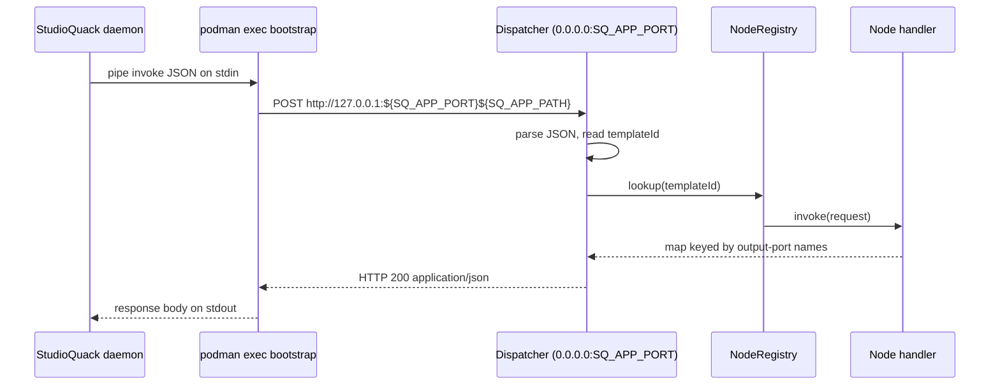
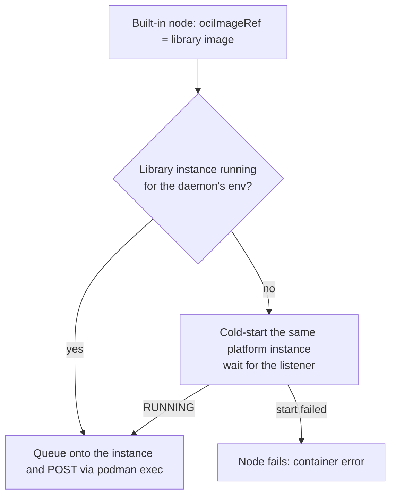

# Dispatcher design

This image is a **multi-node BYO runtime**. The StudioQuack daemon never talks
to individual node processes. It talks to **one HTTP listener**. That listener
is the dispatcher.

The contract below matches the daemon’s stateful invoke path
(`StatefulSandboxExecution` / `StatefulLauncher`), which is the only path the
daemon uses for this image. The dispatcher in `src/` and `helper-src/`
implements it.

## Listener

| Knob | Environment variable | Default |
| --- | --- | --- |
| TCP port | `SQ_APP_PORT` | `8080` |
| URL path | `SQ_APP_PATH` | `/invoke` |

Bind `0.0.0.0:$SQ_APP_PORT` and serve `POST $SQ_APP_PATH` (unary JSON) plus
`POST $SQ_APP_PATH/stream` (NDJSON in, SSE out). Always **read the
environment**; daemons can override the defaults
(`sqs.sandbox.oci.appPort` / `appPath`). Do not publish the port to the host.
The daemon reaches the listener with `podman exec` → `127.0.0.1`.

Ship `curl` (preferred), or `python3`, or `wget`, so the launcher bootstrap can
POST. Ship `python3` so the daemon can plant the helper broker.

## How a request arrives



For every node execution the daemon runs `podman exec -i <container> sh -c
<bootstrap>` against the running library instance and pipes the request JSON
on stdin. The bootstrap POSTs that body to
`http://127.0.0.1:${SQ_APP_PORT:-8080}${SQ_APP_PATH:-/invoke}`.

## Request body

The body is one JSON object. `templateId` is the dispatch key (the node
template id, `NodeDto.data.id` — not the canvas instance id). Typical fields:

```json
{
  "requestId": "…",
  "workflowExecutionId": "…",
  "currentNodeId": "…",
  "envId": "…",
  "templateId": "30f59c3b-afa1-463a-9a60-9cda6ccae790",
  "executionContext": {},
  "inputVariables": {},
  "helperToken": "h_…"
}
```

- `bespokeDir` is present only when the template has uploaded files
  (`/data/sq-bespoke/<templateId>`).
- `helperToken` is the bearer for **this** request on the helper channel. It is
  revoked when the request finishes. **Never log it.**
- Input-port values arrive under `inputVariables` (and also on
  `executionContext.currentNode`). Configuration parameters live on
  `executionContext.currentNode.data.configurationParameters[]` (match
  `shortCode`, read `value`).

Unknown or missing `templateId` must still return **HTTP 200** with a JSON
object that surfaces the error on the node’s error/output ports (or a small
`error` object). Do not use HTTP 4xx/5xx for application failures: `curl`
treats non-2xx as a successful launcher exit with an HTML/error page parsed as
ports; `python3` urllib raises and the whole request becomes `SANDBOX_FAILED`.

## NodeRegistry

On process start the dispatcher loads a registry of `templateId → NodeHandler`.

Sources of ids, in order of typical use:

1. `ENV SQ_TEMPLATE_ID_<KEY>` baked in the `Containerfile` (one per built-in
   node). The value **must equal** `nodes/<kebab-name>/node_definition.json`
   `_id`. Operators can override an id at `podman run -e` without rebuilding
   handlers.
2. In-process registration from each handler’s `main` / Spring bean.
3. Loopback clients that write `/data/sq-apps/<templateId>.json` (optional
   inject path for nodes compiled on the instance volume).

`NodeHandler` is a thread-safe function: given the invoke JSON, return a
`Map<String, Object>` whose **keys are the definition’s OUTPUT port names
exactly**. A mismatched key is silently dropped by the daemon — the port stays
empty and no error is raised.

Keep handlers isolated: one node must not read another node’s in-flight
request, secrets, or `helperToken`.

## Error handling

Throw `studioquack.StudioQuackError(errorCode, message, data)` from a
handler (or call `helper.fail`) so the dispatcher POSTs
`/v1/helper/fail` and answers `200 {}`. The daemon raises
`BpmnError(code)` and routes to the node's error boundary — never put a
top-level `"error"` key on an OUTPUT port (the next node would consume it
as a message). `POST $SQ_APP_PATH/cancel` with
`{requestId, reason}` marks that request cancelled
(`helper.isCancelled()` / `onCancel` / `Thread.interrupt()`);
unknown `requestId` answers `200 {"ok":false}`, a live one
`200 {"ok":true}`.

A failure the dispatcher hits *before* any handler runs — non-POST,
unparseable or oversize body, missing/invalid `templateId`, no handler,
compile-on-miss failure, relay target unreachable — has no trustworthy
helper token to `/fail` with. It answers the reserved envelope
`200 {"__sq_fail": {"errorCode": "DISPATCH_*", "message": "…"}}`
(`StudioQuackDispatch.dispatchFail`), which the daemon's stateful path
turns into a typed `FailureKind.ENGINE` failure without binding the body
to ports. Codes: `DISPATCH_BAD_REQUEST`, `DISPATCH_NO_HANDLER`,
`DISPATCH_UNREACHABLE`, `DISPATCH_COMPILE_FAILED`, `DISPATCH_ERROR`.

## Response

Reply **HTTP 200** with `Content-Type: application/json` and a JSON **object**:

```json
{ "output": { "result": "…" }, "error": "" }
```

Rules:

- Keys = output-port `name` values from the definition.
- A blank body, array, string, or invalid JSON is parsed as zero outputs
  (the node “succeeds” with empty ports).
- If the handler also POSTs `/v1/helper/result`, the helper value **wins** on
  conflict.
- To fail the node deliberately, return 200 **and** `POST /v1/helper/fail`
  with a typed error; helper fail wins over a clean HTTP body.

Bound the request body (the platform cap is 32 MiB: the daemon hydrates each
file to base64 on both `executionContext.currentNode` and `inputVariables`, so
one file rides the body twice). Oversize → 200 with an error object, not an
unbounded parse. Drain the leftover body with bounded `read`s, never `skip` —
on JDK 21 the server's request stream does not bound `skip`, so it blocks on
the keep-alive socket and the caller never gets the reply.

## Stream invocation (`POST /invoke/stream`)

Same listener, path prefix `+ /stream`. The daemon (when it forwards live
frames) POSTs `Content-Type: application/x-ndjson` and reads
`Content-Type: text/event-stream`. The server never buffers the whole body.

Inbound lines (first / middle / last):

```json
{"type":"open","requestId":"<uuid>","templateId":"<id>","input":{},"context":{}}
{"type":"frame","requestId":"<id>","port":"<input port>","channel":"thinking","delta":"…","seq":0}
{"type":"close","requestId":"<id>"}
```

Outbound SSE, flushed incrementally: `event: partial` (`{"channel","delta"}`)
zero or more; exactly one `event: complete` (assembled result) or
`event: error` (`{"error":"<message>"}`); always `event: done` last.

`NodeHandler.handleStream` defaults to: wait for close, assemble per-port
text, call unary `handle`. Override `supportsStreamInput()` and
`handleStream` for true stream-through. Malformed lines become `event: error`
(no stack). Caps: 64 KiB delta, 1024 queued frames (drop-oldest), one line and
one assembled port bounded by the unary body cap (32 MiB), 5-minute idle,
30-minute budget. Never log frame/delta content.

## Helper channel

Callbacks use the Unix socket in `SQ_HELPER_SOCKET` (dummy HTTP base
`http://sq-helper`). There is no host helper listener and no
`host.containers.internal` fallback.

| Item | Meaning |
| --- | --- |
| Socket | Path from `SQ_HELPER_SOCKET` (typically `/tmp/sq-helper.sock`) |
| Auth | Per-request `helperToken` in the invoke body; also `SQ_HELPER_BEARER` / `SQVM_HELPER_TOKEN` on the exec environment |
| Transport | HTTP/1.1 over the Unix socket (curl `--unix-socket`, or the Java helper) |
| Lifetime | Token is valid for this request only; revoked when the dispatch finishes |

If the image lacks `python3`, the daemon cannot plant the broker. The instance
reports `brokerReady=false`, request bodies carry `helperBrokerAbsent`, and
SDK calls fail loudly. This library **must** ship `python3`.

Never log helper frames, tokens, or secret-bearing configuration.

## Concurrency

The daemon may **buffer or serialize** requests per container, or it may
overlap them.

- Images **without** `LABEL studioquack.sqs.dispatch=1` (or `true`) get one
  fair permit (FIFO). Waiters past `stateful-queue.max-depth` are refused with
  `SANDBOX_OVERLOADED`.
- This library sets that label, so the daemon admits up to
  `sqs.sandbox.oci.stateful-dispatch-parallelism` (default **8**) overlapping
  dispatches. Each dispatch still has its own helper job and token.
- The label is advisory: it cannot raise memory/CPU/disk caps. A lying image
  only raises concurrency on its own container.

**The application must be thread-safe.** Shared clients (HTTP pools, parsed
definitions, compiled patterns) may be reused. Request-scoped state
(`helperToken`, `inputVariables`, output maps) must not leak across threads.
Do not use unsynchronized `SimpleDateFormat`, mutable static maps of in-flight
jobs, or a single non-thread-safe HTTP client in a racy way.

Each request is bounded by `sqs.sandbox.oci.requestTimeoutMs` (default 300 s).
On expiry the node fails with `SANDBOX_DEADLINE`.

## Lifecycle: the platform-managed system instance

The daemon owns this image's lifecycle; no operator starts or stops it. It
builds the image on the customer host from the signed release tarball and
keeps **one** stateful instance (`sq-builtin-node-library`, named volume at
`/data`, no CPU/memory/disk limits) running for its environment. Routing is
keyed by the **image ref**, never by a per-node flag:



1. **System instance** — `ScriptDispatchDelegate` resolves the instance in
   memory and admits the request through the per-container queue. Every
   `templateId` shares the same process.
2. **Cold start** — With no live instance, the dispatch starts the same
   platform identity the daemon's supervisor uses (never a second, randomly
   named copy) and serves the request through it. The instance stays up.
3. **No fallback** — A failed cold start fails the node. This image never runs
   in a warm-pool slot or a one-shot container.

A cold start, a supervisor restart and a release update all wait until the
listener accepts TCP on `127.0.0.1:$SQ_APP_PORT` (default timeout 60 s) before
the instance is routable. Bind the listener in `main` before doing expensive
work, or the instance is reported not ready.

Updates replace the instance by drain: a successor starts next to the running
container, routing switches once its listener is up, and the old container
finishes its in-flight requests before it is removed. A run can therefore
execute some nodes on the previous release and the rest on the new one, so
node contracts must stay backward-compatible.

## Related documents

- Adding a node: [adding-a-node.md](adding-a-node.md)
- License: [../LICENSE](../LICENSE) (Apache-2.0)
- Security (tokens, disclosure): [../SECURITY.md](../SECURITY.md)
